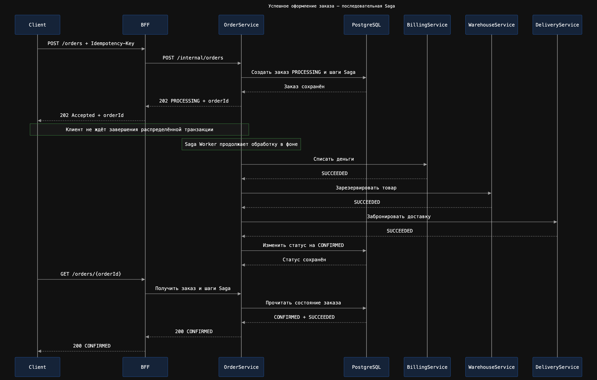
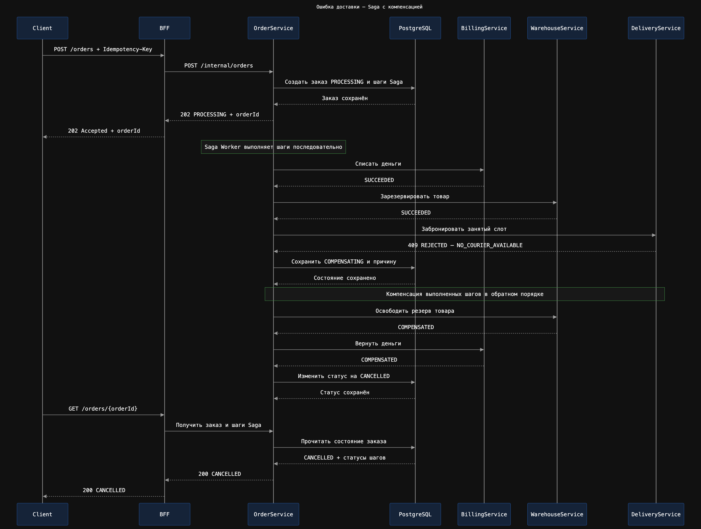

# Онлайн-магазин с использованием микросервисной архитектуры

Проект серверной части онлайн-магазина, разработанный в рамках курса
«Microservice Architecture».

Пользователь может зарегистрироваться, пополнить внутренний тестовый баланс,
выбрать товар и слот доставки, оформить заказ и получить его итоговый статус.

Основной способ воспроизводимой демонстрации — коллекция Postman/Newman. В
репозитории также есть необязательный локальный frontend для ручного прохождения
тех же пользовательских сценариев.

## Критические пользовательские сценарии

### Успешное оформление заказа

1. Пользователь регистрируется и входит в систему.
2. Пополняет внутренний баланс.
3. Получает каталог товаров и доступные слоты доставки.
4. Создаёт заказ.
5. Billing Service списывает деньги.
6. Warehouse Service резервирует товар.
7. Delivery Service бронирует доставку.
8. Заказ получает статус `CONFIRMED`.

### Ошибка оформления заказа

Если оплата, резервирование товара или бронирование доставки завершается
бизнес-отказом, Order Service запускает компенсации:

- возвращает деньги, если оплата уже прошла;
- освобождает товар, если он был зарезервирован;
- переводит заказ в статус `CANCELLED`.

## Архитектура


| Компонент | Ответственность |
|---|---|
| NGINX Ingress | API Gateway и маршрутизация запросов |
| BFF | публичный API и оркестрация пользовательских запросов |
| Auth Service | регистрация, вход и серверные сессии |
| Profile Service | данные пользователя |
| Order Service | заказы и оркестрация Saga |
| Billing Service | баланс, списания и возвраты |
| Warehouse Service | остатки и резервирование товаров |
| Delivery Service | слоты и бронирование доставки |
| PostgreSQL | хранение данных сервисов |

Сервисы используют один экземпляр PostgreSQL для упрощения учебного
развёртывания, но каждый сервис работает только со своими таблицами.

## Распределённая транзакция

Оформление заказа реализовано с помощью Saga с HTTP-оркестрацией.

### Успешное выполнение



### Ошибка и компенсация



Order Service сохраняет состояние каждого шага Saga в PostgreSQL. При временной
ошибке фоновый обработчик повторяет операцию. При бизнес-отказе выполненные шаги
компенсируются в обратном порядке.

## Асинхронная обработка

Создание заказа возвращает `202 Accepted` и статус `PROCESSING`. Обработка Saga
продолжается в фоновом процессе. Клиент получает актуальное состояние запросом:

```http
GET /orders/{orderId}
```

Между участниками Saga используется синхронный HTTP. Брокер сообщений в проекте
не применяется.

## Идемпотентность

Клиент передаёт заголовок `Idempotency-Key` при создании заказа.

- повтор с теми же параметрами возвращает существующий заказ;
- повтор не вызывает дополнительного списания или резервирования;
- изменение параметров с тем же ключом возвращает `409 Conflict`.

## Развёртывание

Backend-компоненты упакованы в Docker-образы и разворачиваются в Kubernetes
namespace `yahu`. Для локального кластера используется Minikube, а для установки
инфраструктурных компонентов — Helm. Frontend запускается отдельно на локальной
машине и в Kubernetes не разворачивается.

Основные технологии:

- Node.js и Koa;
- PostgreSQL;
- Docker;
- Kubernetes и Helm;
- NGINX Ingress;
- Prometheus и Grafana;
- Elasticsearch, Fluent Bit и Kibana;
- HTML, CSS и JavaScript для локального frontend;
- Postman и Newman.

Подробная последовательность развёртывания backend приведена в
[`homework-9/README.md`](homework-9/README.md).

## Проверка и демонстрация

Для локального доступа к Ingress используется адрес
`http://arch.homework:8081`. Порт `8081` пробрасывается командой:

```bash
kubectl port-forward \
  -n yahu \
  service/nginx-ingress-nginx-controller \
  8081:80
```

### Короткий сценарий для тестирования

Коллекция проверяет регистрацию, вход, каталог, слоты доставки, пополнение
баланса, успешный заказ, отказ Delivery с компенсациями и идемпотентные повторы:

```bash
newman run homework-k8s/postman/project-defense.postman_collection.json \
  --env-var baseUrl=http://arch.homework:8081 \
  --reporters cli
```

Контрольный успешный результат:

| Метрика | Выполнено | Ошибок |
|---|---:|---:|
| Requests | 19 | 0 |
| Assertions | 17 | 0 |

В коллекции 17 логических шагов. Фактических HTTP-запросов 19, потому что статус
успешного заказа опрашивается до завершения фоновой Saga.

### Расширенные проверки

Проверка аутентификации и BFF:

```bash
newman run homework-k8s/postman/auth-bff.postman_collection.json \
  --env-var baseUrl=http://arch.homework:8081 \
  --reporters cli
```

Проверка оформления заказов, компенсаций и идемпотентности:

```bash
newman run homework-9/postman/distributed-transactions.postman_collection.json \
  --env-var baseUrl=http://arch.homework:8081 \
  --reporters cli
```

Ожидаемый результат обоих прогонов: `0 failed`.

### Локальный frontend

При работающем port-forward интерфейс запускается отдельно:

```bash
cd homework-k8s/frontend
npm start
```

После запуска приложение доступно по адресу `http://127.0.0.1:5173`. Подробная
инструкция и ограничения находятся в
[`homework-k8s/frontend/README.md`](homework-k8s/frontend/README.md).

## Структура репозитория

- `src`, `migrations` — Profile Service;
- `homework-k8s` — Auth Service, BFF, Ingress, мониторинг и логирование;
- `homework-k8s/frontend` — необязательный локальный пользовательский интерфейс;
- `homework-k8s/postman/project-defense.postman_collection.json` — короткий
  сценарий для тестирования;
- `homework-8` — Billing, Order и Notification Service;
- `homework-9` — Warehouse, Delivery и распределённая транзакция;
- `homework-10` — описание идемпотентности API.
