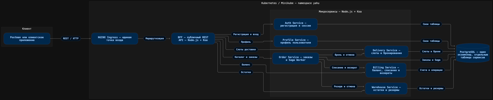

# Контейнерная диаграмма онлайн-магазина

## Что показывает схема

- Внешние запросы поступают через NGINX Ingress в BFF.
- BFF предоставляет единый публичный API и передаёт запросы профильным сервисам.
- Order Service владеет заказом и оркестрирует Saga через HTTP-вызовы.
- Billing, Warehouse и Delivery выполняют локальные операции и компенсации.
- Для учебного развёртывания используется один экземпляр PostgreSQL, при этом
  каждый сервис работает только со своими таблицами.
- Сервисы упакованы в Docker-образы и разворачиваются в Kubernetes с помощью
  Helm; локальное окружение работает в Minikube.
- Kafka и Event Sourcing в текущей версии проекта не используются.

